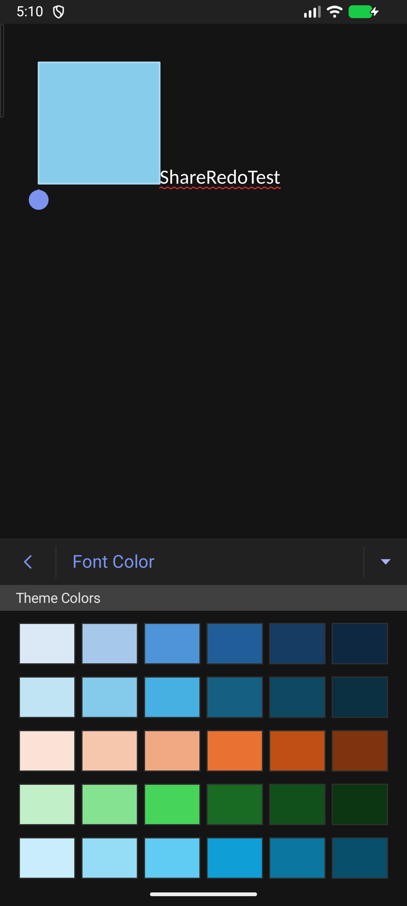
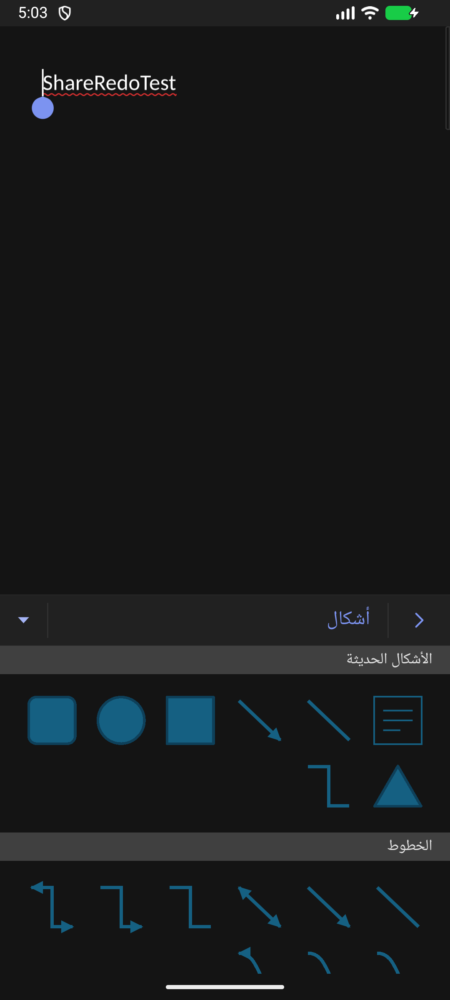

# beta6 — إصلاح معارض الألوان والأشكال والنماذج

هذه التغييرات تخص نسخة Kotlin/Compose في مستودع `hussain-hz/wordcraft-android`، بعد beta5. نسخة المحرك باقية `0.10.0`؛ نسخة التطبيق `0.0.1-beta.6` ورمز APK الشامل `1060`.

## السبب والإصلاح

كانت بعض المعارض تضع صفوفًا بعرض ثابت يقارب 490dp داخل لوحة الهاتف، فتختفي الخيارات عند الطرف. أضيف مكوّن شبكة يستخدم عرض اللوحة الفعلي وعدد أعمدة يتكيف معه، مع هوامش متماثلة وتمرير رأسي للوصول إلى بقية الصفوف. ينعكس اتجاه الصفوف حسب لغة الواجهة.

## تدرجات الألوان ومنع تكرارها

- تعرض ألوان السمة كل عائلة لونية متجاورة من الفاتح إلى الداكن، بدل خلط العائلات عند التفاف الصفوف.
- جُمعت عائلات الرمادي المحايدة في مجموعة واحدة تحت «درجات الرمادي» بعد العائلات الملونة.
- أزيل تكرار قيم RGB المتطابقة، مع الاحتفاظ بكل قيمة فريدة كانت في ألوان السمة. لا يغيّر ذلك تعريف السمة أو ألوان محتوى المستند.
- الألوان المتشابهة ذات قيم RGB مختلفة تبقى درجات مستقلة داخل مجموعتها؛ إزالة التكرار تستهدف التطابق الفعلي.
- أُعيد ترتيب «ألوان إضافية» بحسب عائلة اللون ودرجاته، وأضيفت تسمية عربية/إنجليزية لمجموعة الرمادي.
- عُدلت أهداف اختيار اللون لتشمل مساحة الخلية، مع بيان حالة الاختيار ووصف اللون لإمكانية الوصول.

## المعارض التي أُصلح تخطيطها

| الخيار | التعديل |
|---|---|
| لون الخط، الألوان القياسية، ألوان إضافية | شبكة متجاوبة، تجاور التدرجات، ومنع تكرار ألوان السمة |
| تمييز النص | إعادة توزيع الخلايا بحسب المساحة |
| ألوان القلم وأداة التمييز في الرسم | استخدام الشبكة المتجاوبة المشتركة |
| تعبئة وحدود الأشكال والرسومات، وتظليل الجداول | تستفيد من إصلاح الألوان المشترك وتجميع الدرجات |
| معرض الأشكال | إعادة توزيع الأشكال الحديثة والخطوط والموصلات وجميع مجموعات الأشكال |
| أنماط الأشكال والرسومات | استبدال صفوف الأنماط السبعة ذات العرض الثابت بشبكة تلتف داخل اللوحة |
| التعداد النقطي والترقيم | توزيع النماذج على صفوف متجاوبة دون فقد الخيارات |
| نماذج الهوامش والورق | توزيع عمودي المعلومات داخل العرض المتاح، والسماح بارتفاع الصف عند التفاف النص |
| نماذج أنماط الصور | ملاءمة صورة المعاينة داخل خليتها مع حواف داخلية |

## معارض أخرى رُوجعت

الظلال والانعكاسات ومعارض أنواع/تخطيطات/أنماط المخططات ولوحات ألوان المخططات ومواضع أرقام الصفحات تستخدم توزيعًا بحسب مساحة الصف أو ملاءمة للصورة بالفعل. رُوجعت مسارات التخطيط في المصدر؛ لا أصف كل نموذج منها بأنه اختُبر بالنقر على هاتف فعلي. قوائم أنماط الجداول والورق والقوالب التي تعرض صفًا لكل خيار رُوجعت ضمن مسارات العرض.

## التحقق

- **18 اختبار Android JVM** ناجحًا، تتضمن 6 اختبارات لمشكلة الأعمدة والتدرجات والتكرار، إلى جانب الاختبارات الـ12 القائمة.
- اختبارات الأعمدة تشمل عرض الهاتف المعتاد والعرض الضيق وتقسيم الشاشة وعرض الجهاز اللوحي، وحد الأعمدة عند تغير المساحة.
- اختبار تجاور الدرجات يتحقق من جمع درجات اللون نفسه، واختبار التكرار يتحقق من تساوي مجموعة قيم RGB الفريدة قبل العرض وبعده.
- **4 فحوص موارد عربية** ناجحة. القاموس بعد إضافة «درجات الرمادي» يحوي 495 عبارة واجهة.
- فُحصت بصريًا ألوان الخط والأشكال وأنماطها على محاكي API 37/x86_64، مع عرض ضيق 320dp وعرض المحاكي المعتاد، ووضع أفقي.
- فُحص ترتيب تدرجات لون الخط بالعربية والإنجليزية، وجُرّب التمرير إلى الخيارات السفلية، واختيار شكل وإدراجه.
- أعيد بناء APK وفحص سلامة ZIP وبصمة SHA-256. هذه اختبارات واجهة؛ لم تتغير مكتبات المحرك في هذا التحديث، ولم تُعَد مجموعة اختبارات دمج المحرك كاملة.
- لم تُختبر هذه الدفعة على هاتف ARM فعلي. APK تجريبي debug شامل arm64-v8a وx86_64.

 

[تحميل beta6](https://github.com/hussain-hz/wordcraft-android/releases/tag/v0.0.1-beta.6) · [تقرير beta5 السابق](UPDATE-REPORT-ar.md)
