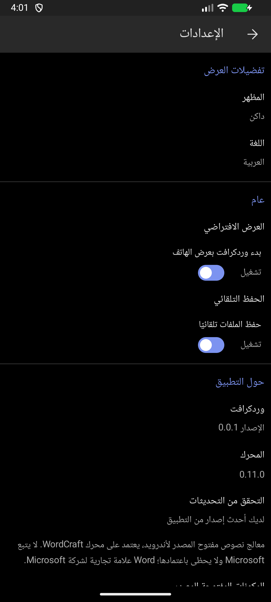
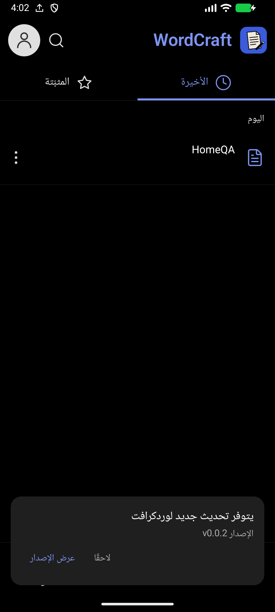
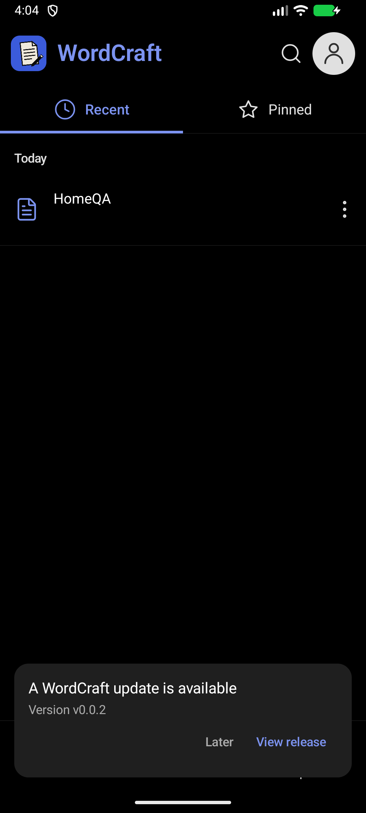

# إصدار Android ‏0.0.1 — المحرك 0.11.0

هذا التقرير يخص التغييرات منذ beta6 في مستودع `hussain-hz/wordcraft-android` فقط.

## دمج المحرك

- دمج فرق الإصدار الرسمي [0.10.0 إلى 0.11.0](https://github.com/storytold/wordcraft/compare/v0.10.0...v0.11.0) في مكتبات المستندات والتخطيط والتنسيقات والتدقيق والرسم وPDF والمحرك.
- مصدر 0.11.0 هو الالتزام `e31f2f06a5f8004ceaa88f68c00b47908e321aa4`، مع تحديث مكتبة PDF التابعة إلى مراجعة `17744430be327d0257496a6a31c8d38fe20a6756`.
- الاحتفاظ بإطارات الصور والظلال والانعكاسات والحواف الناعمة وملفات SVG الأصلية وأدوات المخططات والتدرجات والشفافية وواجهتي العربية والإنجليزية.
- لم تُحذف أي معرّفات أوامر `CommandSpec::new` الموجودة قبل الترقية. ظهرت أوامر إضافية للتنقل في سجلات المراسلات والطباعة ولون صفحة القراءة؛ توفر أمر في المحرك لا يعني إضافة لوحة جديدة له في Android.
- تكييف مسارات الرسم مع نهايات الخطوط الجديدة، وربط أسماء الأسهم الجديدة بحفظ الأشكال، والإبقاء على معاينة الصور وتصدير SVG.
- تبني قيود فك الصور واستهلاك الذاكرة الجديدة. الإطار في Android يبقى بيانات تنسيق قابلة للتراجع ولا يُرسم فوق البكسلات الأصلية؛ مسار التأثيرات النقطية البديل يطبق حدود الذاكرة أيضًا.
- دمج اختبارات DOCX والمحرك في مواقعها الجديدة دون فقد اختبارات الحفظ الخاصة بالصور وSVG. حذف اختبارات متطابقة لتجنب تنافسها على المجلد المؤقت نفسه.

## تحديث التطبيق من GitHub Releases

- فحص آخر إصدار منشور غير تجريبي من مستودع التطبيق، لا إصدارات المحرك.
- مقارنة SemVer بالأرقام: `0.0.10` أحدث من `0.0.9`، والإصدار النهائي أحدث من beta لنفس الرقم. تجاهل المسودات والإصدارات التجريبية والإصدارات بلا APK مرفوع.
- فحص عند فتح التطبيق، مع تخزين نتيجة ناجحة لمدة ست ساعات لتجنب الطلبات المتكررة. «التحقق من التحديثات» في الإعدادات يجري فحصًا فوريًا.
- مهمة نظام مستمرة كل 24 ساعة تقريبًا عند توفر الشبكة، تستمر بعد إعادة تشغيل الهاتف. Android يحدد وقت تنفيذ العمل في الخلفية وقد يؤجله لتوفير الطاقة.
- تنبيه داخل التطبيق متوافق مع الثيم وRTL/LTR، وإشعار نظام مرة واحدة لكل إصدار عند السماح بالإشعارات. رفض الإذن لا يمنع التنبيه داخل التطبيق أو الفحص اليدوي.
- «عرض الإصدار» والإشعار يفتحان صفحة الإصدار على GitHub للتنزيل. لا تنزيل أو تثبيت تلقائي، ولا إرسال لمحتوى المستندات.
- اتصال HTTPS بمهلات زمنية وحد أقصى لحجم الاستجابة. تعذر الاتصال يظهر كتعذر تحقق، ولا يُعرض على أنه عدم وجود تحديث.
- عرض إصدار التطبيق وإصدار المحرك كلٍّ في سطر مستقل في الإعدادات، وإضافة عشر ترجمات ليصبح الكتالوج 505 تسميات ثنائية اللغة.

## ملفات الإصدار والتوقيع

| الملف | الاستخدام |
|---|---|
| `WordCraft-0.0.1-release.apk` | نسخة Release موقّعة بمفتاح خاص، مع تصغير الشفرة والموارد، ومعرّف `io.github.artcraftandroid.wordcraft` |
| `WordCraft-0.0.1-beta-upgrade.apk` | نسخة توافق لترقية beta السابقة في مكانها، بمعرّف `.debug` وتوقيعها السابق، للحفاظ على بياناتها الداخلية |
| `WordCraft-0.0.1-SHA256SUMS.txt` | بصمات التحقق من ملفي APK |

كلتا الحزمتين تحملان إصدار التطبيق `0.0.1` ورمز النسخة `1990` والمحرك `0.11.0`، وتحتويان `arm64-v8a` و`x86_64`. نسخة Release مستقلة عن نسخة beta على Android؛ يمكن تثبيتهما معًا، ولا تنتقل الإعدادات والمسودات الداخلية تلقائيًا بين المعرّفين. لا حاجة لحذف beta لتركيب Release.

بصمة شهادة Release ‏SHA-256:
`7f552dd0f495c740f7df742aca99df4953f0cba169a552093f0feb694d6c6ae9`

المفتاح الخاص وكلمة مروره محفوظان محليًا خارج المستودع ولم يُرفعا إلى GitHub. يجب الاحتفاظ بهما لتمكين تحديث هذه الحزمة مستقبلًا. أصبح بناء Release يتطلب إعدادات التوقيع؛ البناء غير الموقع يحتاج `-Pwordcraft.unsigned=true` صراحةً.

## التحقق وحدوده

- 3217 اختبار Rust ناجحًا عبر 18 هدف اختبار، بما فيها 46 اختبارًا لجسر Android واختبارات الصور والأشكال وDOCX والتراجع والإعادة والرسم وPDF.
- 22 اختبار Kotlin ناجحًا، منها أربعة اختبارات لمقارنة الإصدارات وسياسة قبول تحديث GitHub.
- أربعة اختبارات موارد عربية ناجحة.
- بناء Release وDebug ناجح، وAndroid Lint: صفر أخطاء، مع 36 تحذيرًا وثماني ملاحظات أغلبها اعتماديات وإرشادات توافق موجودة.
- الجولة النهائية لاختبارات Rust متسلسلة لأن اختبارات القاموس المخصص تشترك في حالة داخل العملية؛ التشغيل المتوازي كشف تداخلًا في هذه الاختبارات.
- التحقق من توقيع APK ومن محتويات ZIP ومعماريتي المكتبة الأصلية وبصمات الملفات.
- اختبار على محاكي Android ‏x86_64: الإعدادات وإصدار المحرك، العربية والإنجليزية، تنبيه تحديث افتراضي، إذن الإشعارات ووصول إشعار عربي، وتسجيل المهمة الدورية، وتشغيل حزمة Release المصغرة وفتح النموذج والكتابة والتراجع والإعادة. الإصدار `v0.0.2` الظاهر في صور الاختبار بيانات اختبار محلية وليس إصدارًا منشورًا.
- لا يُدّعى اختبار هاتف ARM فعلي أو انتظار دورة خلفية مدتها 24 ساعة؛ المهمة الدورية خاضعة لجدولة Android. تُستعاد بيانات التحديث الأصلية بعد اختبار التنبيه الافتراضي.





## إعادة البناء

من `apps/wordcraft-android/android`، اضبط `ANDROID_HOME` و`WORDCRAFT_KEYSTORE` و`WORDCRAFT_KEYSTORE_PASSWORD` و`WORDCRAFT_KEY_ALIAS` و`WORDCRAFT_KEY_PASSWORD` في البيئة دون حفظها في Git، ثم نفّذ:

```text
gradlew assembleRelease assembleDebug testDebugUnitTest lintRelease -Pwordcraft.abis=arm64-v8a,x86_64 -Pwordcraft.ndkVersion=30.0.16248370 -Pkotlin.compiler.execution.strategy=in-process
```

تحديثات GitHub المستقبلية يجب أن تحمل رقم تطبيق أعلى في `gradle.properties` ووسمًا مطابقًا مثل `v0.0.2`، وأن تُنشر كإصدار غير تجريبي مع APK مكتمل الرفع. حدّث الحزمة بنفس معرّفها ومفتاح توقيعها.
