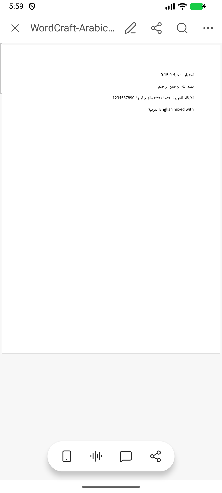

# WordCraft 0.0.11 — إصلاح ملاءمة عرض الصفحات

## التغيير

عند فتح مستند بوضع الجوال ثم الانتقال إلى عرض الصفحات، كان التطبيق يستخدم نسبة التكبير المحفوظة داخل المستند، وقد تكون أكبر من شاشة الهاتف. أصبح الانتقال يبدأ بملاءمة عرض الصفحة داخل الشاشة، حتى عند تكرار التبديل بعد التكبير اليدوي. تُهيّأ مساحة العرض الجديدة أيضًا عندما تتطابق أبعاد الصفحات مع الحالة السابقة.

الإصلاح عام في واجهة عرض المستندات، ولا يغيّر تنسيق المستند أو محتواه. يبقى فتح المستند مباشرة بوضع الصفحات على سلوكه السابق في قراءة التكبير المحفوظ. يحتفظ المستخدم بإمكانية التكبير يدويًا بعد الانتقال.

## التحقق

- نجحت اختبارات Kotlin الـ45، ومنها اختبار تحديث ملاءمة الصفحة بعد وصول أبعاد التخطيط واختبار الاحتفاظ بالتكبير اليدوي عند تغيّر مساحة لوحة المفاتيح.
- نجح اختبار على المحاكي يتحقق من ظهور حافتي الصفحة داخل الشاشة بعد الانتقال من وضع الجوال، ثم يعيد الاختبار بعد التكبير اليدوي والعودة إلى وضع الجوال.
- نجح بناء Release وتحسين R8 وتصغير الموارد. انتهى Lint دون أخطاء، مع 42 تحذيرًا و13 ملاحظة.
- وُقّعت الحزمة بمفتاح الإنتاج نفسه المستخدم في 0.0.10. نجح تثبيتها فوق 0.0.10 على محاكي WordCraft المخصص دون حذف التطبيق أو بياناته.
- فُتح مستند عربي موجود من القائمة الأخيرة في حزمة Release، ثم جرى التبديل إلى عرض الصفحات وفحص الملاءمة بصريًا. سجل الانهيارات فارغ.
- المكتبتان الأصليتان لمعمارية arm64-v8a وx86_64 متطابقتان بايتًا ببايت مع 0.0.10؛ المحرك 0.15.0.
- لم تُجر تجربة على هاتف فعلي في هذه الجولة.

## الحزمة

- الإصدار: **0.0.11**، رمز الحزمة **11990**.
- المعرّف: `io.github.artcraftandroid.wordcraft`.
- الملف: `WordCraft-0.0.11-release.apk`، لمعمارية arm64-v8a وx86_64.
- الحجم: **86677533 بايت**.
- SHA-256: `ba0a882b774210b250fd5a8639fa48038235f9d61a3464172245b0aae5bdf7fa`.
- شهادة الإنتاج SHA-256: `527c0c506a4a08f6b0f2468835f621e738c65285dcd58e34ae628d79570bdacd`.
- تحقق توقيع APK ومحاذاة المكتبات لصفحات 16 KiB.

يمكن التحديث مباشرة من 0.0.10. الإصدارات الأقدم التي تستخدم المفتاح القديم تحتاج إجراء الانتقال الموضح في [تقرير 0.0.10](RELEASE-0.0.10-ar.md).

[تنزيل الإصدار](https://github.com/hussain-hz/wordcraft-android/releases/tag/v0.0.11). ملاحظات الإصدار بالعربية والإنجليزية في [ملف النشر](RELEASE-0.0.11-notes.md).
