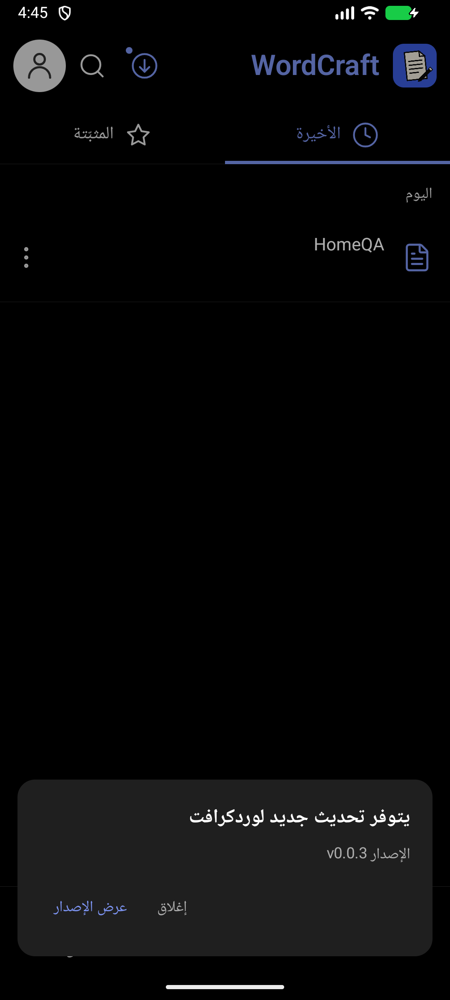
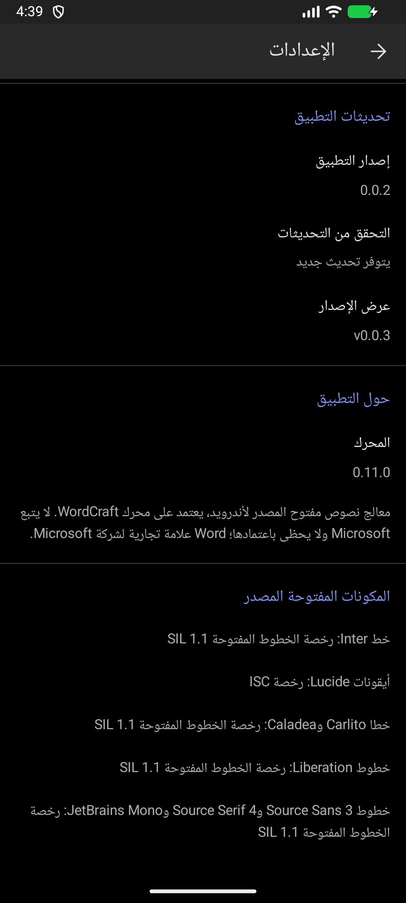
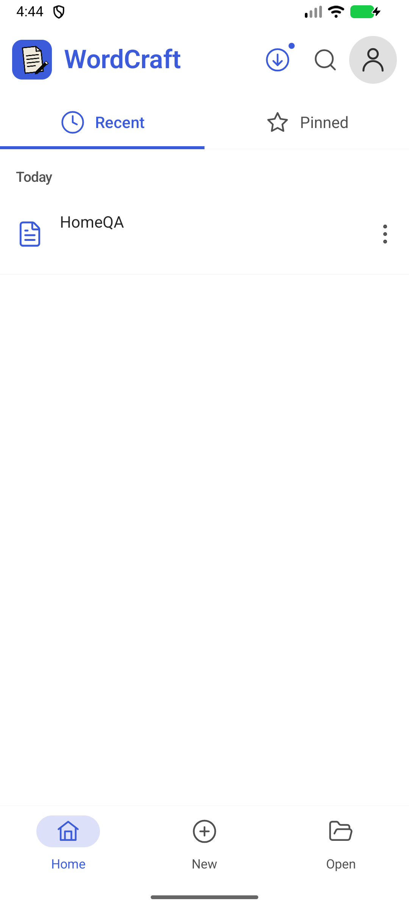
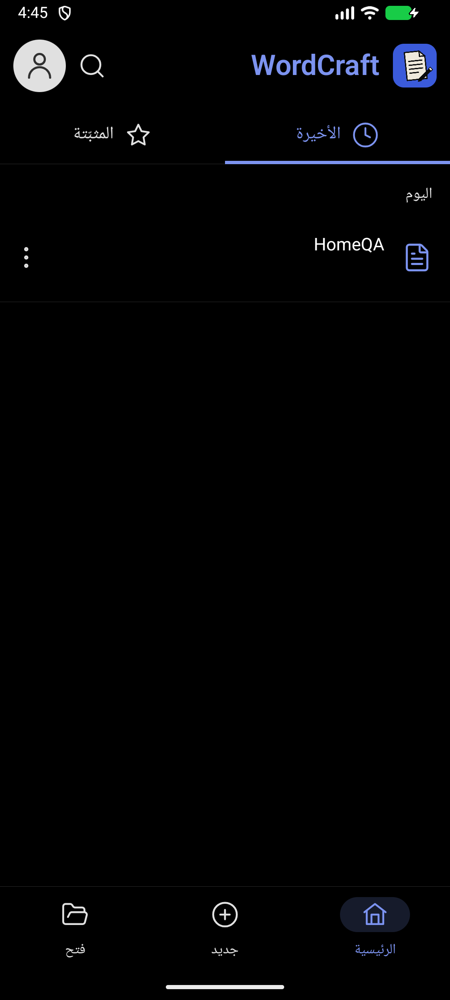

# إصدار 0.0.2 — أيقونة التحديث وتنظيم الإعدادات

التغييرات منذ إصدار 0.0.1:

- إلغاء طلب إذن إشعارات Android وإزالة `POST_NOTIFICATIONS` من الحزمتين. تنظيف إشعار وقناة الإصدار السابق عند الترقية.
- الفحص التلقائي يبقى صامتًا، وعند توفر نسخة أحدث تظهر أيقونة دائرية بسهم تنزيل أعلى الرئيسية بلون الثيم وسماكة بقية الأيقونات.
- تفاصيل التحديث لا تفتح تلقائيًا. الضغط على الأيقونة يفتحها، ويمكن إغلاقها بزر الإغلاق أو الرجوع أو الضغط خارجها؛ «عرض الإصدار» يفتح GitHub.
- ظهور الأيقونة يتبع توفر تحديث فعلي، ويُحدَّث أيضًا عند العودة للتطبيق بعد فحص الخلفية. لا يظهر إشعار نظام.
- تقسيم الإعدادات إلى «تحديثات التطبيق» لإصدار التطبيق والتحقق والتنزيل، و«حول التطبيق» للمحرك والتعريف، و«المكونات المفتوحة المصدر» للتراخيص. كل مصدر في سطر مستقل مع مسافات قراءة موحدة.
- دعم العربية RTL والإنجليزية LTR والثيمين الفاتح والداكن. إضافة ترجمة «إصدار التطبيق»، ليصبح الكتالوج 506 تسميات ثنائية اللغة.

المحرك باقٍ على 0.11.0. رقم التطبيق 0.0.2 ورمز الحزمتين 2990. Release موقعة بالمفتاح الخاص نفسه لإصدار 0.0.1، ونسخة beta-upgrade تحافظ على معرّف وتوقيع نسخ beta السابقة.

## التحقق

- 22 اختبار Kotlin وأربعة اختبارات موارد عربية ناجحة، وبناء الحزمتين وفحص Android Lint بلا أخطاء. اختبارات المحرك الـ3217 موثقة في إصدار 0.0.1؛ لم يتغير Rust في هذا الإصدار.
- فحص صلاحيات APK للتأكد من غياب إذن الإشعارات.
- فحص المحاكي: أيقونة دون فتح تلقائي، فتح التفاصيل وإغلاقها، فصل أقسام الإعدادات، العربية الداكنة والإنجليزية الفاتحة، واختفاء الأيقونة عند عدم وجود تحديث.
- بيانات الإصدار v0.0.3 في صور الاختبار محلية افتراضية فقط؛ تُستعاد بيانات المحاكي الأصلية بعد الفحص. لم يُرسل APK إلى الهاتف ولم يُدّع اختبار جهاز ARM فعلي.

## التنزيل

- `WordCraft-0.0.2-release.apk`: لتحديث Release 0.0.1 أو التثبيت الجديد.
- `WordCraft-0.0.2-beta-upgrade.apk`: لترقية نسخ beta وحزمة beta-upgrade 0.0.1 في مكانها.
- `WordCraft-0.0.2-SHA256SUMS.txt`: بصمات التحقق. كلا APK يدعمان arm64-v8a وx86_64.

