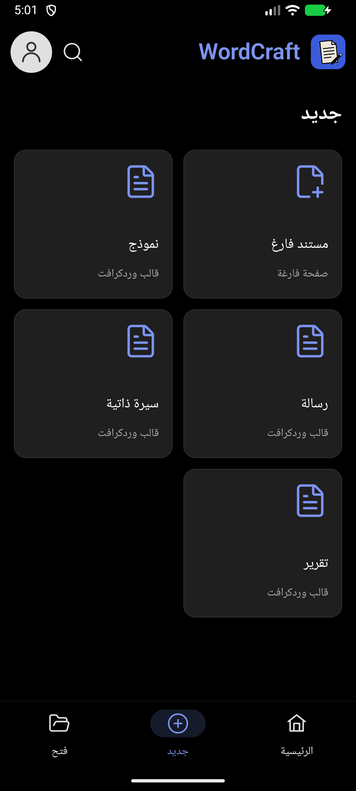
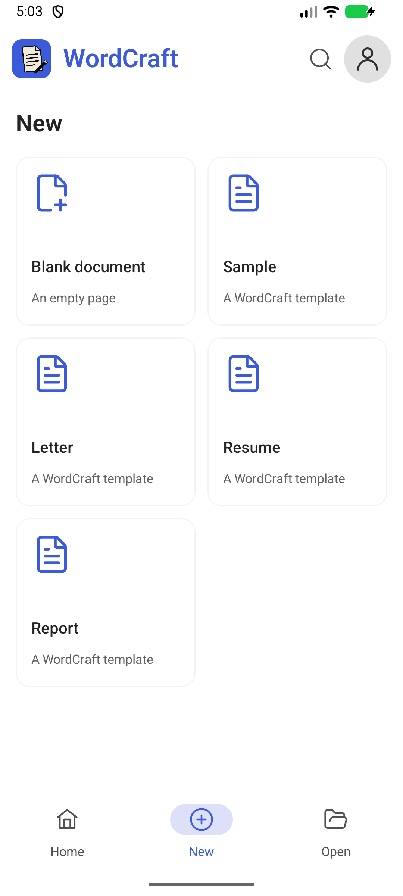

# إصدار 0.0.3 — تبويب جديد مستقل

- الضغط على «جديد» في الشريط السفلي ينقل إلى صفحة مستقلة داخل التطبيق، مع تمييز تبويب «جديد» بدل «الرئيسية».
- إلغاء القائمة السفلية التي كانت تظهر فوق الرئيسية، وإخفاء «الأخيرة/المثبتة» داخل صفحة جديد.
- عرض المستند الفارغ والنموذج والرسالة والسيرة الذاتية والتقرير كبطاقات في شبكة تتكيف مع العرض ويمكن تمريرها.
- إبقاء الشريط السفلي ظاهرًا للتنقل بين الصفحات. الرجوع من جديد يعيد إلى الرئيسية، والعودة من المستند تُبقي جديد محددًا.
- حفظ التبويب في ViewModel ليبقى متسقًا عند الانتقال للمحرر أو الإعدادات. البحث عن المستندات ينتقل إلى الرئيسية.
- الحفاظ على ثيم التطبيق والعربية RTL والإنجليزية LTR، وعلى أيقونة التحديث الدائرية التي تظهر فقط عند توفر تحديث.

## التحقق

22 اختبار Kotlin وأربعة اختبارات موارد عربية ناجحة، وبناء Release ونسخة التوافق، وفحص Android Lint بلا أخطاء. فحص المحاكي شمل التبويب العربي الداكن والإنجليزي الفاتح، تمييز زر جديد، الرجوع إلى الرئيسية، وإنشاء مستند فارغ والعودة إلى جديد. المحرك لم يتغير عن 0.11.0، ولم يُختبر هاتف ARM فعلي.

إصدار التطبيق 0.0.3 ورمز الحزمتين 3990. `WordCraft-0.0.3-release.apk` يحدث Release بنفس مفتاح التوقيع، و`WordCraft-0.0.3-beta-upgrade.apk` يحدث الحزمة التجريبية السابقة في مكانها. كلتا الحزمتين تدعمان arm64-v8a وx86_64، ومعهما ملف SHA256SUMS للتحقق.

