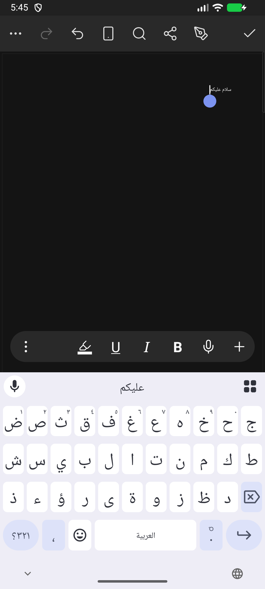

# إصدار 0.0.4 — إصلاح الكتابة العربية والإنجليزية

يعالج هذا الإصدار تداخل النص الجديد مع النص الموجود وتكرار آخر كلمة عند تعديلها بلوحة المفاتيح. التغيير يخص مسار إدخال Android المشترك بين اللغات؛ المحرك يبقى 0.11.0 بأدواته الحالية.

## السبب والإصلاح

كان النص الجاري تركيبه بلوحة المفاتيح يُرسم مؤقتًا فوق الصفحة خارج نص المحرك، فلا يعيد توزيع الكلمات. كذلك لم يكن تحديد منطقة تركيب داخل كلمة موجودة مدعومًا، وكانت نهاية التركيب قد تضيف الكلمة مرة أخرى.

- أصبح النص الجاري كتابته جزءًا فعليًا من المستند ويُنسّق بواسطة المحرك، وأُلغي الرسم المؤقت المتداخل.
- اعتماد مخزن Editable وBaseInputConnection لمعالجة تركيب الكلمات، تحديد النص، واستبدال كلمة قديمة في مكانها.
- إرسال فرق النص والموضع إلى المحرك بعملية متزامنة، مع تحويل إزاحات UTF-16 إلى حدود صحيحة في نص Rust، دون شطر الرموز التعبيرية.
- إنهاء التركيب أو إغلاق اتصال لوحة المفاتيح لا يضيف النص مرة أخرى. الاتصالات القديمة ترفض الكتابة بعد إعادة إنشائها.
- تحديث تحديد المؤشر والنص المستخرج للوحات المفاتيح، وإعادة مزامنة المخزن بعد التراجع والإعادة والإملاء والتصحيح التلقائي.
- المحافظة على حماية المستند، وخيار استبدال التحديد، ومسار إدخال المعادلات القائم.

مثال أُعيد إنتاجه على 0.0.3: تعديل «الرحيم» في «بسم الله الرحمن الرحيم» إلى «الكريم» كان ينتج «بسم الله الرحمن الرحيمالكريم». في 0.0.4 تصبح «بسم الله الرحمن الكريم» وتبقى كذلك بعد إنهاء التركيب. أُعيد الاختبار على Release الموقعة أيضًا.

## التحقق

- 53 اختبار Rust لجسر Android، تشمل 7 اختبارات جديدة للتركيب العربي والإنجليزي، تعديل وسط النص، حدود الفقرات، الحماية، الرموز والتشكيل، وحفظ النص الجاري تركيبه في DOCX وتصديره إلى PDF.
- 29 اختبار Kotlin، تشمل 7 اختبارات جديدة لحساب فرق النص والتحديد، وأربعة اختبارات موارد عربية.
- 23 عملية فعلية عبر InputConnection على محاكي Android: تركيب تدريجي، تعديل كلمة موجودة، الإدراج وسط النص، الحذف حسب نقاط Unicode، وإنهاء التركيب. فُحصت نتيجة التراجع والإعادة من المحرك أيضًا.
- كتابة «سلام عليكم» مباشرة بمفاتيح Gboard العربية، ثم المسافة وتبديل لوحة المفاتيح؛ بقي النص في المحرك دون تكرار.
- بناء Release الموقعة ونسخة ترقية beta للمعماريتين arm64-v8a وx86_64، وفحص التوقيع وسلامة الأرشيف والبصمات. Android Lint: صفر أخطاء، 33 تحذيرًا و8 ملاحظات.

التحقق التفاعلي تم على محاكي x86_64؛ لم تُختبر لوحة Samsung أو هاتف ARM فعلي، ولم تُعد مجموعة اختبارات المحرك الكاملة في هذا الإصدار. اختبارات جسر Android والبناء لا تُغني عن تجربة لوحة مفاتيح المستخدم على هاتفه.

## التنزيل والترقية

[ملفات الإصدار 0.0.4](https://github.com/hussain-hz/wordcraft-android/releases/tag/v0.0.4):

- `WordCraft-0.0.4-release.apk`: تحديث حزمة Release بمفتاح التوقيع نفسه.
- `WordCraft-0.0.4-SHA256SUMS.txt`: بصمات التحقق.

رمز النسخة 4990. أُزيل ملف ترقية beta من تنزيلات هذا الإصدار بعد انتهاء الحاجة إليه؛ ستُعتمد حزمة Release وحدها للإصدارات القادمة. لم يُرسل هذا الإصدار إلى الهاتف تلقائيًا.
