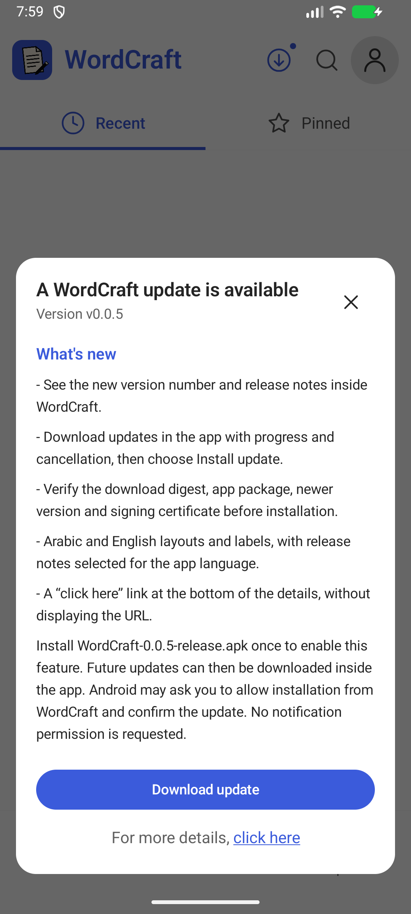
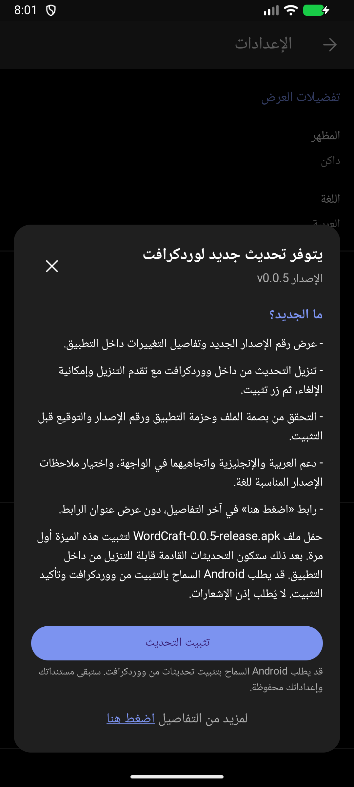

# إصدار 0.0.5 — التحديث من داخل التطبيق

## الواجهة والسلوك

- تستمر أيقونة التحديث الدائرية في الظهور عند توفر إصدار أحدث فقط، دون نافذة تلقائية أو إذن إشعارات.
- الضغط على الأيقونة أو «تفاصيل التحديث» في الإعدادات يفتح لوحة متناسقة مع ثيم التطبيق، فيها رقم الإصدار و«ما الجديد؟» وملاحظات الإصدار المنشورة على GitHub.
- دعم العربية RTL والإنجليزية LTR للنصوص والأزرار والمحاذاة. تُنشر ملاحظات الإصدار بقسمين يفصل بينهما `<!-- lang:ar -->` و`<!-- lang:en -->`؛ يختار التطبيق القسم المناسب. الملاحظات القديمة ذات اللغة الواحدة تُعرض كما نُشرت دون ترجمة آلية.
- زر «تنزيل التحديث» يعرض التقدم، مع إمكانية الإلغاء وحذف الملف المؤقت وإعادة المحاولة عند الفشل.
- بعد اكتمال التحقق يظهر زر «تثبيت التحديث». قد يطلب Android السماح بالتثبيت من ووردكرافت؛ بعد الرجوع بالموافقة يفتح تأكيد التثبيت. رفض الإذن لا يبدأ التثبيت.
- في النهاية تظهر «لمزيد من التفاصيل اضغط هنا»، والرابط على «اضغط هنا» فقط؛ بالإنجليزية “For more details, click here”.

## التنزيل والتحقق

تُختار حزمة `WordCraft-<version>-release.apk` المنشورة في مستودع التطبيق، مع حجم معلوم وبصمة SHA-256 من GitHub. التنزيل عبر HTTPS إلى مجلد مؤقت خاص، بحد 350 MiB ومهلات اتصال وقراءة وعدد تحويلات محدود. تُقبل تحويلات GitHub إلى نطاقات ملفات إصداراته المعروفة.

قبل إظهار التثبيت، وعند تسليم الملف إلى مثبّت Android، يُفحص الحجم والبصمة ومعرف الحزمة ورقم النسخة وكونها أحدث من المثبتة ومطابقة شهادة التوقيع. يصل المثبّت للملف عبر FileProvider وصلاحية قراءة مؤقتة. لا يُطلب إذن التخزين أو الإشعارات، ولا يحدث تثبيت صامت.

التنزيل مرتبط بعملية التطبيق؛ إغلاق لوحة التفاصيل لا يلغيه، أما إنهاء عملية التطبيق بواسطة النظام فقد يوقفه، وعند إعادة المحاولة يبدأ من جديد. لا توجد خدمة تنزيل دائمة أو استئناف جزئي في هذا الإصدار.

## التحقق

36 اختبار Kotlin، منها 7 اختبارات جديدة لسياسة ملفات التحديث والنطاق والحجم والبصمة واختيار الملاحظات العربية والإنجليزية، وأربعة اختبارات موارد عربية. فُحصت لوحة التفاصيل بالعربية والإنجليزية على المحاكي، والإلغاء وتنظيف الملف المؤقت والتنزيل الفعلي ورفض الحزمة غير المطابقة ورفض البصمة غير الصحيحة بعد التنزيل. البناء الموقّع وفحص سلامة APK وتوقيعه ومعماريتيه وبصمته ناجحة؛ Android Lint بلا أخطاء، مع 35 تحذيرًا و10 ملاحظات. المحرك لم يتغير عن 0.11.0؛ لم تُعد اختبارات Rust في هذا التحديث.

اختبار الترقية الكامل استخدم عميل التحديث نفسه داخل نسخة اختبار محلية مرقمة 0.0.4 (4990)، ثم نزّل حزمة 0.0.5 المنشورة من GitHub. نجح التحقق وفتح شاشة السماح بالتثبيت ثم تأكيد مثبّت Android، وأصبحت النسخة المثبتة 0.0.5 (5990). استمر التنزيل عند إغلاق التفاصيل وتغيير اللغة والثيم، وبقيت العربية والثيم الداكن بعد الترقية واختفت أيقونة التحديث. نسخة الاختبار المحلية ليست ملف 0.0.4 القديم المنشور، ولم تُنشر كتنزيل للمستخدمين.

الاختبارات التفاعلية على محاكي Android x86_64؛ لم يُختبر هاتف ARM فعلي. تتضمن حزمة Release المعماريتين arm64-v8a وx86_64 بنفس مفتاح التوقيع السابق.

## التنزيل

[الإصدار 0.0.5](https://github.com/hussain-hz/wordcraft-android/releases/tag/v0.0.5) يتضمن حزمة تطبيق واحدة `WordCraft-0.0.5-release.apk` وملف SHA256SUMS. رمز النسخة 5990. يجب تثبيت 0.0.5 مرة واحدة بالطريقة الحالية لتفعيل هذه الميزة؛ بعدها يمكن تنزيل الإصدارات القادمة من داخل التطبيق. لم يُرسل APK إلى هاتف المستخدم تلقائيًا.

