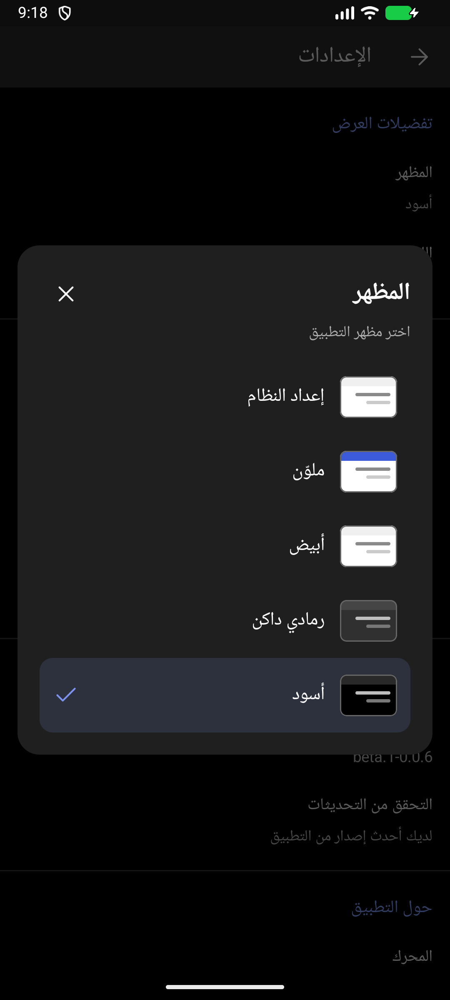
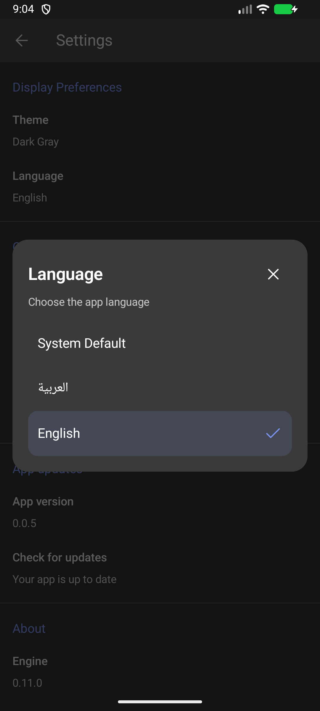

# نسخة الاختبار 0.0.6-beta.1

## ما الجديد؟

- إضافة مظاهر جديدة للتطبيق: الملوّن والرمادي الداكن، إلى جانب الأبيض والأسود وإعداد النظام.
- تحسين نافذتي اختيار المظهر واللغة وعرضهما وسط الشاشة بتصميم موحّد.
- إضافة معاينات صغيرة للمظاهر وتمييز الخيار المحدد.
- تحسين تناسق ألوان الواجهة والأيقونات وشريط الحالة.
- تحسين دعم العربية والإنجليزية واتجاه العرض.
- تثبيت اسم التطبيق WordCraft

## حالة النسخة

هذه نسخة Pre-release للاختبار وجمع الملاحظات، ولم تُعتمد إصدارًا مستقرًا. يبقى 0.0.5 الإصدار المستقر، ويتجاهل التحقق التلقائي داخل التطبيق الإصدارات التجريبية. المحرك يبقى 0.11.0.

ملف الاختبار هو `WordCraft-0.0.6-beta.1-test.apk`، برقم نسخة 6010 ومعرّف الحزمة الأساسية نفسه وتوقيعها نفسه، ويمكن تثبيته كتحديث لها. يدعم arm64-v8a وx86_64. لا توجد حزمة beta-upgrade منفصلة.

## التنفيذ والتحقق

الألوان موزعة على أدوار موحدة للرئيسية والإعدادات وشريطي القراءة والتحرير وشريط الحالة. تحافظ مفاتيح المظهر السابقة على الاختيار المحفوظ، وتستخدم نافذتا اللغة والمظهر مكوّنًا مشتركًا متمركزًا، بعلامة تحديد للخيار النشط وزر إغلاق وقائمة قابلة للتمرير. اسم تطبيق Android ثابت بالإنجليزية في جميع اللغات.

نجح بناء Debug وAPK الاختبار الموقّع وفحص Lint بلا أخطاء، مع 36 اختبار Kotlin وأربعة اختبارات موارد عربية ناجحة. فُحصت الواجهة بالعربية والإنجليزية على محاكي x86_64، مع تبديل المظهر واللغة، والتمرير في الوضع الأفقي، وحفظ الاختيار بعد إعادة الفتح، وإغلاق النافذة دون تغيير الإعداد. فُحص توقيع الحزمة ومعرّفها ورقمها ومعماريتاها وسلامة أرشيفها واسمها الإنجليزي وبصمتها، وثُبّت APK الموقّع كتحديث على المحاكي وشُغّل بنجاح. لم تُجرَ تجربة على هاتف ARM فعلي بعد؛ اعتماد النسخة ينتظر تجربة المستخدم.

