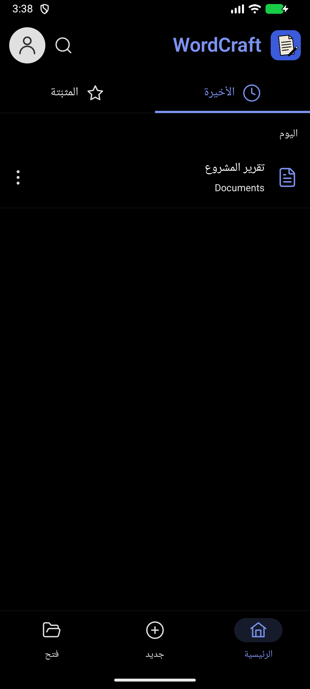
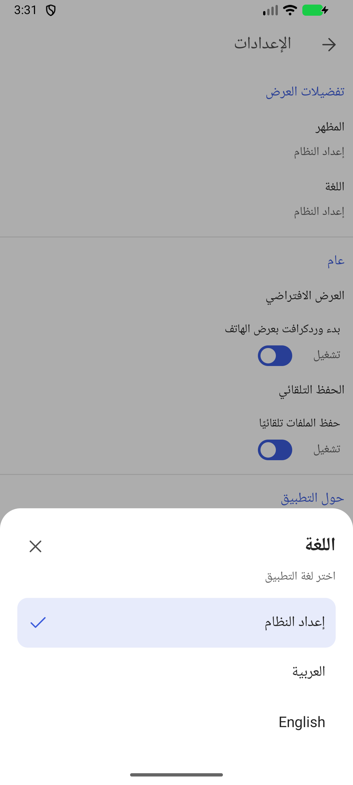

# تقرير تحديث WordCraft Android — beta5

تاريخ التسليم: 26 أكتوبر 2026. نسخة التطبيق `0.0.1-beta.5`، نسخة المحرك `0.10.0`، ورمز APK الشامل `1050`.

هذا التقرير يصف التغييرات الموجودة في هذا المستودع والبناء المنشور معها. يشمل ترقية المحرك والتعريب والتحسينات اللاحقة حتى beta5.

## 1. ترقية المحرك مع الحفاظ على أدوات Android

- دُمج إصدار WordCraft الرسمي `v0.10.0` من الالتزام `9130181a5fdaee2293e67756fd5458c601489f3c` مع تخصيصات Android الموجودة في الفرع.
- حُدّث نموذج التعبئة والتدرجات والشفافية وحدود الأشكال ليتوافق مع واجهات الرسم الجديدة.
- احتُفظ بإطارات الصور والظلال والانعكاس والحواف الناعمة وملفات SVG الأصلية في العرض والتصدير.
- احتُفظ بخيارات المخططات والألوان والأنماط، بما فيها المخططات الرادارية والأسهم، مع احترام إخفاء علامات كل سلسلة.
- أُعيد ربط أوامر Android التي لا يوفرها المحرك الرسمي بنفس الصورة، وأزيل تسجيل أمر مكرر.
- أُصلح تحديث ذاكرة التخطيط عند تبديل عرض المراجعات، مع الحفاظ على عرض الهاتف وإبراز الكلمات أثناء القراءة الصوتية.
- احتُفظ باختيار ترميز النص وقراءة مستندات Android، وأضيف اختبار لمنع تراجع قراءة الملفات العادية.
- أضيف تسجيل لأخطاء Rust الأصلية في logcat للمساعدة في تشخيص الأعطال اللاحقة.

التفاصيل الفنية: [تقرير دمج المحرك](engine-upgrade-status.md). المصدر الأصلي: [WordCraft v0.10.0](https://github.com/storytold/wordcraft/releases/tag/v0.10.0).

## 2. التعريب واتجاه الواجهة

- أضيف قاموس ثنائي اللغة يحوي **494 عبارة واجهة**، وموارد Android للعربية والإنجليزية.
- شمل ربط الموارد القوائم والإعدادات والتعليقات ولوحات الأدوات والبحث عن الأوامر ورسائل التطبيق.
- أضيف تعريف اللغات المدعومة ودعم اتجاه اليمين إلى اليسار، وعُكست حركة التنقل بحسب اللغة.
- بقيت أسماء الملفات والخطوط ومحتويات المستندات نصوصًا أصلية؛ تبديل لغة الواجهة لا يترجم المستند.
- أضيفت أداة إعادة توليد الموارد من القاموس وأربعة فحوص لتطابق الموارد والمعاملات وعدم ترجمة محتوى المستند.

## 3. إصلاح المشاركة والتراجع والإعادة — beta3

- كانت أزرار المشاركة الثلاثة في واجهة المستند متصلة بالحفظ. أصبحت تستدعي تصدير النسخة الحالية من المستند ثم نافذة مشاركة Android.
- أضيف زر **إعادة** بجوار **تراجع** في شريط التحرير العلوي، ويرتبط تفعيله بتاريخ التعديلات في المحرك.
- ضُبط عرض أزرار الشريط ليتسع لها صف واحد، وأضيفت تسميات عربية وإنجليزية لإمكانية الوصول إلى المشاركة والتراجع والإعادة.
- اختُبر نص تجريبي: أزاله التراجع، وأعادته الإعادة. وفتح زر المشاركة ملف DOCX يحتوي آخر النص المكتوب، دون إرسال مستند الاختبار إلى جهة خارجية.

## 4. إعادة تصميم الرئيسية واختيار اللغة — beta4

- أضيف عنوان WordCraft وأيقونة الحساب التي تفتح الإعدادات، مع البحث في أسماء المستندات.
- أضيف تبويبا **الأخيرة** و**المثبّتة**، ومؤشر واضح للتبويب النشط.
- أضيف تثبيت المستند وإلغاء تثبيته من قائمة النقاط الثلاث، مع حفظ الاختيار بعد إعادة تشغيل التطبيق.
- أصبحت الأزرار السفلية **الرئيسية، جديد، فتح**. يفتح «جديد» المستند الفارغ والقوالب، ويستدعي «فتح» منتقي مستندات الهاتف.
- نُسقت صفوف المستندات والقوائم والأيقونات مع هوية WordCraft الزرقاء، مع دعم المظهرين الفاتح والداكن وخلفية سوداء للرئيسية في الداكن.
- أضيفت حالات واضحة للقائمة الفارغة وعدم وجود نتائج بحث.
- أضيف في الإعدادات اختيار **العربية، English، إعداد النظام** داخل قائمة سفلية. يتغير الاتجاه فورًا ويُحفظ الاختيار.
- يتكامل الاختيار مع واجهة لغة التطبيق في Android 13 فأحدث؛ ويستخدم سياق موارد الواجهة للأنظمة الأقدم المدعومة.

## 5. ترتيب رأس الرئيسية — beta5

- أصبحت صورة التطبيق قبل اسم **WordCraft** في بداية الرأس.
- انتقلت أيقونة الحساب إلى جوار البحث على اليسار في العربية.
- ينعكس الترتيب تلقائيًا في الإنجليزية، ويُحصر اسم التطبيق في سطر واحد.

<p align="center"> </p>

## 6. البناء والتحقق

| التحقق | النتيجة |
|---|---|
| المكتبات الأساسية وجسر Android | 1988 اختبارًا ناجحًا |
| PDF والرسم النقطي | 59 + 55 اختبارًا ناجحًا |
| توافق إضافات Android | اختباران ناجحان؛ أحدهما محسوب ضمن التشغيل الأساسي |
| قراءة ملف عادي | اختبار إضافي ناجح |
| موارد العربية | 4 فحوص ناجحة |
| اختبارات Android JVM | 12 اختبارًا ناجحًا |
| APK beta5 | بناء ناجح؛ arm64-v8a وx86_64؛ فحص ZIP وSHA-256 |
| مراجعة الواجهة | العربية والإنجليزية، RTL/LTR، الرئيسية الفاتحة والداكنة، اختيار اللغة، البحث، التثبيت وحفظه |
| التحرير والمشاركة | كتابة عربية مباشرة، جدول، تراجع وإعادة، نافذة مشاركة وDOCX يحوي آخر التعديلات |

أعيد تشغيل اختبارات مناسبة لكل تعديل؛ أرقام المكتبات أعلاه من تحقق دمج المحرك، وليست ادعاءً بإعادة تشغيلها كاملة بعد كل تغيير بصري. مجموع التحقق يتجاوز 2100 اختبار دون احتساب إعادة التشغيل مرتين.

## 7. حدود الاختبار والنسخة المنشورة

- الاختبارات العملية على محاكي API 37 يستخدم x86_64. لم تُختبر النسخة الأخيرة على هاتف ARM فعلي، ولم يُنفذ اختبار عملي على Android 10–12.
- بناء ARM فقط يتعطل في طبقة ترجمة ARM في هذا المحاكي؛ حدث ذلك أيضًا في البناء القديم. يعمل البناء الشامل باستخدام x86_64 الأصلي للمحاكي، ويحوي arm64-v8a للهواتف.
- جُرّب حل باستخدام الرسم دون SIMD ثم أُلغي لأنه لم يحل عطل الترجمة. بقي إعداد أداء الرسم الأصلي.
- APK المنشور بناء **debug تجريبي** بمفتاح التصحيح المحلي، وليس إصدار متجر بمفتاح إنتاج. تحديث تثبيت موجود يتطلب توافق توقيع النسختين.
- تتوفر ملفات APK وبصمتها في [إصدارات هذا المستودع](https://github.com/hussain-hz/wordcraft-android/releases)، ولا تُحفظ داخل شجرة المصدر.

## 8. مسارات العمل للمطور

- تطبيق Android: [`apps/wordcraft-android/android`](../apps/wordcraft-android/android).
- الواجهات: `app/src/main/java/io/github/artcraftandroid/wordcraft/ui` داخل مجلد Android.
- موارد اللغة: `app/src/main/res/values/ui_strings.xml` و`values-ar/ui_strings.xml`.
- قاموس الترجمة: [`arabic-labels.json`](arabic-labels.json).
- توليد الموارد: `python tools/generate_arabic_resources.py` من جذر المستودع.
- فحص الموارد: `python tools/test_arabic_resources.py`.

أوامر التحقق والبناء من مجلد Android (مع توفير Android SDK وJDK وRust وcargo-ndk):

```sh
./gradlew :app:testDebugUnitTest :app:assembleDebug -Pwordcraft.abis=arm64-v8a,x86_64 -Pwordcraft.ndkVersion=30.0.16248370
```

استُخدم NDK `30.0.16248370` للبناء المحلي المرفق. القيمة الافتراضية في المشروع ما زالت `29.0.14206865` ويمكن تجاوزها بالخاصية أعلاه.

## 9. تفاصيل ما تغير في واجهات المستند والأدوات

هذه التفاصيل تميز بين **تطوير الواجهة** و**تعريب أداة كانت موجودة**؛ نقل اسم الأداة إلى الموارد العربية لا يعني أن وظيفتها أُنشئت من الصفر.

| القسم | التغيير الفعلي في هذه الدفعة |
|---|---|
| شاشة المستند في وضع القراءة | ربط زر المشاركة بالتصدير والمشاركة، وتعريب رسائل العرض والعودة للقراءة |
| شاشة المستند في وضع التحرير | إضافة حالة `canRedo` وأمر الإعادة للشريط، وإصلاح زر المشاركة |
| شريط القراءة السفلي | إصلاح ثالث مسار للمشاركة؛ لم يعد يستدعي الحفظ فقط |
| ترتيب الشريط العلوي | حساب عرض الأزرار بحسب مساحة الشاشة، وإظهار التراجع والإعادة معًا |
| تسميات إمكانية الوصول | إضافة وصف للمشاركة والتراجع والإعادة، مترجم بحسب لغة الواجهة |
| لوحة تبويبات الأدوات | تعريب أسماء التبويبات وعناوين اللوحات وعناصر الاختيار وأقسام الأدوات |
| تنسيق الفقرات | تعريب عناوين المسافات البادئة وتباعد الأسطر والخيارات التابعة لها |
| الجداول | تعريب خيارات الأنماط والمربعات التابعة لها؛ اختُبر عرض جدول ولوحته في RTL وLTR |
| الهوامش والورق | تعريب أسماء الإعدادات، أعلى/أسفل وداخل/خارج ويمين/يسار؛ فصل ترجمة Letter كمقاس ورق عن Letter كقالب خطاب |
| الأنماط والألوان | تعريب أسماء الأنماط الثابتة وعناصر المعارض واختيار عدم وجود لون |
| الرسم | تعريب القوائم الثابتة وقياس السمك دون تغيير قيم المستند |
| التعليقات | تعريب أوامر وعبارات الواجهة مع إبقاء نص التعليق الذي كتبه المستخدم كما هو |
| البحث والاستبدال | تعريب الحقول والنتائج والعدادات وأوامر الاستبدال والإعدادات |
| البحث عن الأوامر Tell Me | إضافة المطابقة بالاسم العربي المترجم بجانب المطابقة الإنجليزية، وإزالة النتائج المكررة |
| القراءة الصوتية | تعريب واجهة سرعة القراءة وعناصرها والرسائل المرتبطة بتوفر الصوت؛ محرك النطق يستخدم خدمة الهاتف الموجودة |
| ترميز الملفات النصية | تعريب شاشة الاختيار والعناوين؛ معاينة النص نفسها لا تمر عبر ترجمة الواجهة |
| تأكيد إغلاق المستند | تعريب حفظ/عدم حفظ/إلغاء والسؤال الذي يتضمن اسم المستند |
| رسائل التطبيق | تعريب فشل الفتح والحفظ وإعادة الفتح والاختصارات وتشغيل المحرك ونتائج الاستبدال |
| التنقل | تعكس انتقالات الشاشات وأسهم الرجوع اتجاه العربية والإنجليزية |

### المشاركة: ما الذي يحدث عند الضغط؟

1. تثبَّت الكتابة المركبة الحالية من لوحة المفاتيح في المحرك قبل التصدير.
2. تُصدّر نسخة من المستند بحالته الحالية إلى ملف مشاركة في ذاكرة التطبيق المؤقتة.
3. ينشئ `FileProvider` رابط محتوى ويمنح التطبيق المستقبِل إذن القراءة.
4. تفتح نافذة مشاركة Android ليختار المستخدم التطبيق والجهة.

كان مسار المشاركة و`FileProvider` موجودين سابقًا؛ الإصلاح هنا هو توصيل الأزرار الثلاثة بهما بدل ربطها بالحفظ. مشاركة PDF من القائمة كانت وظيفة قائمة ولم أقدّمها كأداة جديدة من الصفر.

### الإعادة: متى يكون الزر متاحًا؟

- بعد تعديل يمكن التراجع عنه، يتاح زر «تراجع» بحسب حالة المحرك.
- بعد التراجع، يصبح زر «إعادة» متاحًا إذا بقيت خطوة في سجل الإعادة.
- عند عدم وجود خطوة قابلة للإعادة يظهر الزر معطّلًا، ولا ينفذ أمرًا وهميًا.
- تستخدم الأزرار تاريخ التعديلات نفسه؛ لم يُنشأ سجل موازٍ داخل الواجهة.

## 10. تفاصيل الرئيسية والإعدادات وسلوك كل زر

### الرأس

في العربية: صورة التطبيق واسم WordCraft في اليمين، والبحث والحساب في اليسار. في الإنجليزية ينعكس ترتيب صف الواجهة. الأيقونات متجهة ومرسومة وفق شبكة وسُمك أيقونات التطبيق، مع سهم رجوع قابل للعكس.

**أيقونة الحساب تفتح الإعدادات فقط** في هذه النسخة. لم أضف إنشاء حساب أو تسجيل دخول أو مزامنة سحابية أو خادمًا للمستخدمين.

### البحث

- البحث في اسم المستند داخل التبويب الحالي: الأخيرة أو المثبتة.
- يظهر حقل الكتابة في الرأس ويطلب التركيز عند فتحه.
- إغلاق البحث يمسح عبارة البحث؛ زر الرجوع ينهي البحث قبل مغادرة الشاشة.
- تظهر رسالة عربية/إنجليزية عند عدم وجود نتيجة.

### المستندات والمثبّتة

- تبقى الأخيرة مرتبة وفق سجل الفتح ومقسمة زمنيًا: اليوم، أمس، هذا الأسبوع، سابقًا.
- «تثبيت» يضيف المستند إلى المثبّتة داخل التطبيق، و«إلغاء التثبيت» يعكس ذلك.
- التثبيت محفوظ في إعدادات التطبيق ويستمر بعد إعادة تشغيله.
- «إضافة إلى الشاشة الرئيسية» خيار مختلف: يطلب اختصارًا من مشغّل الهاتف، وليس تثبيتًا في تبويب المثبتة.
- «إزالة من القائمة» يحذف السجل من الأخيرة؛ **لا يحذف الملف الأصلي من الهاتف**.
- صف المستند قابل للنقر لفتحه، وزر النقاط الثلاث مستقل لخياراته وبلا إطار مرسوم حوله.

### الأزرار السفلية

- **الرئيسية:** تعيد عرض الأخيرة وتنهي البحث الحالي.
- **جديد:** تفتح القائمة السفلية للمستند الفارغ أو نموذج أو خطاب أو سيرة ذاتية أو تقرير. القوالب الأساسية كانت موجودة وأُبقيت، وأعيد تنظيم الوصول إليها.
- **فتح:** يستدعي منتقي مستندات Android الموجود في التطبيق؛ لم يُستبدل بنافذة ملفات كمبيوتر.

### اللغة والمظهر

- «العربية» تفرض موارد العربية واتجاه RTL على الواجهة.
- «English» تفرض الإنجليزية واتجاه LTR.
- «إعداد النظام» يتبع لغة الهاتف.
- يحفظ الاختيار فورًا؛ لا يحتاج المستخدم إلى تغيير لغة الهاتف لتغيير لغة التطبيق.
- أضيفت قائمة اللغة السفلية بخيار محدد وعلامة اختيار وزر إغلاق.
- المظهر الفاتح/الداكن/حسب النظام إعداد موجود سابقًا؛ التغيير الجديد يشمل تصميم الرئيسية في هذه الأوضاع، ولم يُضف مظهر مستقل ثالث.

## 11. أين جرى العمل داخل المحرك؟

معظم الأسطر الكثيرة في التحديث تأتي من دمج الإصدار الرسمي ومن اختباراته، وليست ادعاءً بأنني كتبت المحرك كله أو جميع مزاياه من الصفر.

| جزء المصدر | ما شمله الدمج أو التكييف |
|---|---|
| `crates/doc` | نموذج المستند والتعبئة والحدود والأشكال والجداول والنصوص والكائنات وفق 0.10 |
| `crates/docx` | قراءة وكتابة DOCX، الصور وSVG والأنماط والأشكال والمخططات، والتوافق مع النموذج الجديد |
| `crates/docbin` | تحديث قارئ تنسيق Word الثنائي واختباراته من الإصدار الرسمي |
| `crates/engine` | الأوامر والتحرير والملفات والمراجعات والحماية والجداول والحقول والمراجع والتعافي والقراءة الصوتية، مع إعادة توصيل إضافات Android |
| `crates/layout` | التخطيط والقياس والاتجاهات والكائنات والتخزين المؤقت، وتكييف أوامر الرسم مع النموذج الجديد |
| `crates/render` | واجهات الرسم والتعبئة والمؤثرات وSVG وتجميع سياقات الرسم من 0.10 |
| `crates/pdf` | تكييف تصدير PDF مع أوامر الرسم الجديدة والمؤثرات وصور SVG الأصلية |
| `crates/formats` | تحديث قارئات/كتّاب الصيغ الموجودة مثل ODT وRTF وHTML وMarkdown وTXT من المصدر الرسمي |
| `crates/fonts` | تحديث اختيار الخطوط وخصائص النصوص والرموز وقياساتها من المصدر الرسمي |
| `crates/proof` | دمج ملفات وقواعد التدقيق واللغات التي جاء بها المصدر الرسمي؛ هذا ليس إعلانًا عن إضافة مدقق إملائي عربي |
| `crates/geom` و`crates/metafile` | تحديث أدوات الهندسة ورسوم ملفات التعريف التي تعتمد عليها عملية الاستيراد والرسم |
| `apps/wordcraft-android/src/lib.rs` | الإبقاء على جسر Android وإضافة تسجيل أخطاء Rust الأصلية |
| `Cargo.toml` و`Cargo.lock` | تثبيت نسخة المحرك والاعتماديات المتوافقة في مساحة العمل |

### ثلاثة اختبارات توافق أُضيفت خصيصًا لهذه الترقية

1. **تدرج الشكل وشفافيته:** حفظ DOCX ثم فتحه والتحقق من بقاء ألوان نقاط التدرج وشفافيتها، والتحقق من أن تطبيق تعبئة جديدة يتغلب على خصائص التعبئة القديمة.
2. **أنماط الصور وSVG:** تطبيق إطار ومؤثرات وحفظ الملف وإعادة فتحه، والتحقق من بقاء الإطار والمؤثرات وSVG بجانب الصورة البديلة.
3. **قراءة الملف العادي:** التحقق من مطابقة البايتات، بما فيها نص عربي، ورفض المجلد والملف المفقود عبر مساري القراءة.

### أمور حافظنا عليها أثناء الدمج وليست إضافات جديدة من الصفر

إطارات الصور، الظلال، الانعكاس، الحواف الناعمة، أصول SVG، قوالب الأشكال وضبطها، خيارات المخططات وألوانها، عرض الهاتف، التنقل بين العناوين، تمييز كلمات القراءة الصوتية، واختيار ترميز النص. استلزم الحفاظ عليها تعديل طبقة التوافق لأن واجهات المحرك الرسمي تغيّرت.

## 12. مطالب سابقة لا يصح اعتبارها منجزة في beta5 لمجرد وجودها في المحادثة

هذه النسخة المرفوعة هي مشروع Kotlin/Compose الموجود في المستودع. بعض الصور والطلبات القديمة تتعلق بواجهات أخرى في سياق العمل؛ لا أعتبرها مُنفذة في هذا البناء بلا دليل من الكود والتحقق.

| المطلب السابق | الحالة في المصدر المرفوع |
|---|---|
| جعل الاسم الطويل يتحرك تلقائيًا | صف الأخيرة الحالي يختصر الاسم الطويل بعلامة الحذف؛ لم تُضف حركة الاسم |
| إعادة التسمية في موضع الاسم | غير موجودة في قائمة الأخيرة الحالية |
| زر حذف الملف من قائمة الأخيرة | الموجود «إزالة من القائمة»، وليس حذف الملف الأصلي |
| حصر الرئيسية في خمسة مستندات وإظهار البقية في صفحة ملفات | الرئيسية الحالية تعرض سجل الأخيرة؛ لم يُضف هذا التقسيم |
| صفحة أدوات مستقلة ببطاقات PDF والقوالب والإحصاءات والاستعادة | ليست موجودة كصفحة مستقلة في التنقل الحالي، رغم وجود بعض الوظائف في المحرك أو القوائم |
| زر الشريط الكامل وشريط أدوات عريض بنفس شكل الصور القديمة | واجهة Compose الحالية تستخدم لوحات الأدوات الخاصة بها؛ لم يُضف ذلك الزر في هذه الدفعة |
| زر التركيز بجانب زر الملاءمة في شريط سفلي | لم يُضف بهذا الترتيب في واجهة Compose الحالية |
| التخلص من جميع النوافذ العائمة في كل التطبيق | غير مكتمل؛ ما زالت توجد حوارات Material مثل تأكيد حفظ التغييرات واختيار المظهر |
| ضمان عدم ظهور لوحة المفاتيح تلقائيًا في كل حالات الدخول | لم يجر اختبار شامل لكل مسارات الدخول؛ فتح مستند فارغ للتحرير أثناء الاختبار أظهر لوحة المفاتيح |
| اختبار كل أداة وكل نافذة على الهاتف الفعلي | لم يتم؛ تفاصيل التغطية الفعلية محددة في قسم الاختبارات |

هذه القائمة تسجل الفجوة بوضوح، ولا تغيّر وظائف التطبيق أو تنفّذ المطالب المتبقية ضمن تحديث التوثيق.

## 13. ماذا رُفع إلى GitHub بالضبط؟

- رُفع الكود إلى فرع `main`، بما فيه دمج المحرك والواجهات والموارد والاختبارات.
- الالتزام الأول الجامع للتغييرات هو [`f9954b9`](https://github.com/hussain-hz/wordcraft-android/commit/f9954b902ae9b130d20101a78443d53d67833c85)، ويشمل 257 ملفًا معدّلًا أو مضافًا.
- نُشر إصدار `v0.0.1-beta.5` كإصدار تجريبي، وأُرفق APK وبصمته SHA-256.
- طابقت بصمة APK على GitHub الملف المحلي، وتحقق اكتمال رفع المرفقين وتطابق `main` مع الالتزام المحلي.
- أُضيفت صور واجهة فعلية من المحاكي إلى التوثيق. المستند الظاهر فيها بيانات اختبار أُنشئت للتحقق.
- لم تُرفع مفاتيح توقيع أو حسابات أو بيانات مستندات شخصية أو مجلدات البناء المحلية إلى شجرة المصدر.
- هذا التوسع في الشرح **تحديث توثيق فقط**؛ ملف APK beta5 المنشور لم يتغير.

[قائمة جميع الملفات المرفوعة، مجمعة بحسب الجزء](CHANGE-MAP-ar.md) · [عرض الفروق الكاملة](https://github.com/hussain-hz/wordcraft-android/commit/f9954b902ae9b130d20101a78443d53d67833c85)
